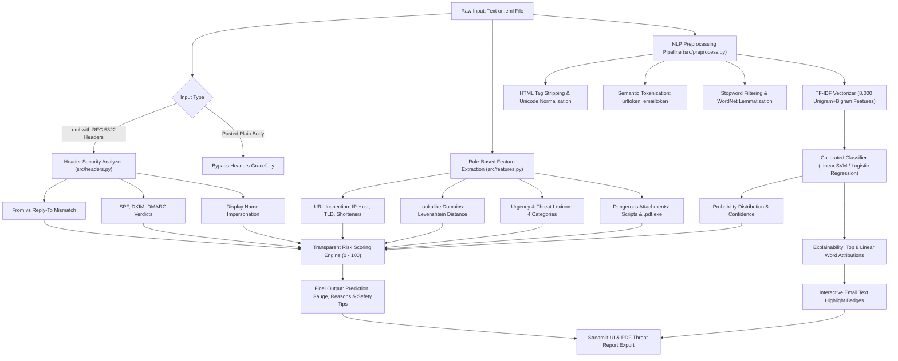

# AI-Based Email Phishing Detection System

A complete, production-grade, explainable machine learning system that detects and explains **Legitimate**, **Spam**, and **Phishing** emails. The system evaluates email text, attachment metadata, URL structures, and email headers (RFC 5322) to output a multi-class prediction, confidence probability, top influential word attributions, and a transparent **Risk Score (0–100)** with actionable safety tips.

---

## 📑 Table of Contents
- [Architecture & Workflow](#architecture--workflow)
- [Project Directory Structure](#project-directory-structure)
- [Dataset Details (Phase 1)](#dataset-details-phase-1)
- [NLP Preprocessing Pipeline (Phase 2)](#nlp-preprocessing-pipeline-phase-2)
- [Model Benchmark Results (Phase 3)](#model-benchmark-results-phase-3)
- [Explainability & Detection Features (Phase 4)](#explainability--detection-features-phase-4)
- [Streamlit UI & Capabilities (Phase 5)](#streamlit-ui--capabilities-phase-5)
- [Honest Fresh Samples Evaluation (Phase 7)](#honest-fresh-samples-evaluation-phase-7)
- [Risk Scoring Formula & Weights](#risk-scoring-formula--weights)
- [Limitations & Future Work](#limitations--future-work)
- [Viva Voce Technical Guide](#viva-voce-technical-guide)
- [Exact Run Commands](#exact-run-commands)

---

## 🏗️ Architecture & Workflow



---

## 📁 Project Directory Structure

```
phishing-detector/
├── data/
│   ├── raw/                  # Downloaded public tar.bz2 and mbox archives
│   ├── emails.csv            # Cleaned, balanced dataset (Legitimate, Spam, Phishing)
│   ├── emails_cleaned.csv    # Preprocessed cache for fast model training
│   ├── history.db            # SQLite scan log and user feedback database
│   └── nltk_data/            # Local self-contained NLTK corpora (stopwords, wordnet)
├── models/
│   ├── vectorizer.joblib     # Fitted TF-IDF Vectorizer (8,000 features, unigram + bigram)
│   ├── best_model.joblib     # Top-performing model (Linear SVM Calibrated)
│   ├── naive_bayes.joblib    # Multinomial Naive Bayes (Core Model 1)
│   ├── logistic_regression.joblib # Logistic Regression (Core Model 2)
│   ├── linear_svm.joblib     # Calibrated Linear SVM (Comparison Model 1)
│   ├── random_forest.joblib  # Random Forest (Comparison Model 2)
│   └── metrics.json          # Complete JSON metrics, params, and cross-validation scores
├── reports/
│   ├── eda_class_distribution.png   # Class balance bar chart
│   ├── eda_length_distribution.png  # Character and word length distributions
│   ├── eda_top_words.png            # Top 15 keywords per class
│   ├── eda_summary.json             # Dataset statistical summary
│   ├── confusion_matrix_*.png       # Confusion matrices for each model
│   ├── confusion_matrices_all.png   # Consolidated 2x2 comparison grid
│   ├── roc_curves_*.png             # One-vs-Rest ROC curves per model
│   ├── roc_comparison.png           # Phishing class ROC comparison across models
│   ├── model_comparison.png         # Benchmark metrics comparison bar chart
│   └── errors.csv                   # Comprehensive test set misclassification analysis
├── src/
│   ├── data_loader.py        # Automated archive download, parsing, and EDA generation
│   ├── preprocess.py         # Unified clean_text() pipeline for training & inference
│   ├── features.py           # URL red flags, brand lookalike, urgency, attachment rules
│   ├── headers.py            # RFC 5322 header parsing & authentication analyzer
│   ├── train.py              # 5-fold CV, GridSearchCV tuning, benchmarking, export
│   ├── predict.py            # Inference engine, top 8 word attributions, risk scoring
│   ├── history.py            # SQLite audit trail and feedback management
│   └── report.py             # Professional PDF Threat Report generator (fpdf2)
├── tests/
│   ├── test_pipeline.py      # Core NLP, features, headers, and predict tests
│   ├── test_history.py       # SQLite database logging and feedback unit tests
│   ├── test_report.py        # PDF threat report generation tests
│   ├── test_app_smoke.py     # Streamlit app syntax and dependency smoke tests
│   ├── fresh_samples.csv     # 15 realistic unseen test emails (Phase 7)
│   └── evaluate_fresh_samples.py # Honest evaluation script
├── docs/
│   └── viva_notes.md         # Comprehensive viva voce exam defense guide
├── app.py                    # Streamlit Web Application (5 Tabs)
├── Dockerfile                # Containerized deployment specification
├── requirements.txt          # Python dependencies
├── .gitignore                # Git ignore configuration
└── README.md                 # Complete system documentation
```

---

## 📊 Dataset Details (Phase 1)

All data is drawn from verified, canonical public research corpora:
- **Legitimate (Ham)**: Apache SpamAssassin (`easy_ham`, `easy_ham_2`, and `hard_ham`).
- **Spam**: Apache SpamAssassin (`spam` and `spam_2`).
- **Phishing**: Jose Nazario Phishing Corpus (`phishing0.mbox`, `phishing1.mbox`, `phishing2.mbox`).

### Data Cleaning & Curation:
1. Extracted email Subject and Body text using RFC 5322 decoders and BeautifulSoup.
2. Dropped empty messages and very short emails ($< 30$ characters or $< 5$ words).
3. Deduplicated exact and normalized text duplicates.
4. Balanced all 3 classes to **1,648 samples per class** (**4,944 total emails**).

---

## ⚙️ NLP Preprocessing Pipeline (Phase 2)

The `clean_text()` function in `src/preprocess.py` provides identical preprocessing during both training and real-time prediction:

1. **HTML entity decoding & tag removal**: Decodes `&amp;`, `&lt;`, and strips all HTML tags via BeautifulSoup with regex fallback.
2. **Unicode normalization**: Applied NFKD unicode decomposition.
3. **Lowercasing**: Standardizes case sensitivity.
4. **Entity Marker Tokenization**:
   - URLs $\to$ `urltoken`
   - Email addresses $\to$ `emailtoken`
   - Currency amounts ($\$, €, £) $\to$ `currencytoken`
   - Numeric digits $\to$ `numbertoken`
5. **Punctuation removal**: Strips non-alphanumeric symbols while maintaining inter-word spacing.
6. **Stopword removal**: Removes non-informative English stopwords from NLTK.
7. **Lemmatization**: Reduces inflected word forms to base dictionary lemmas via NLTK's `WordNetLemmatizer`.

---

## 🚀 Model Benchmark Results (Phase 3)

### Validation Methodology:
- **Split**: 80% Training (3,955 samples), 20% Held-Out Testing (989 samples) with Stratification.
- **Validation**: 5-Fold Stratified Cross-Validation on the training partition.
- **Vectorization**: TF-IDF with unigrams and bigrams (`ngram_range=(1, 2)`), `sublinear_tf=True`, `max_features=8000`, `min_df=3`.
- **Hyperparameter Optimization**: `GridSearchCV` on all models optimizing for `macro-F1`.
- **Calibration**: Linear SVM wrapped with `CalibratedClassifierCV(method='sigmoid')` for reliable posterior probabilities.

### Test Set Benchmark Table (Directly from `models/metrics.json`):

| Model | Test Accuracy | Macro-F1 | Phishing-F1 | Macro-AUC | 5-Fold CV Macro-F1 | Best Parameters |
| :--- | :---: | :---: | :---: | :---: | :---: | :--- |
| **Linear SVM (Calibrated) [BEST]** | **97.57%** | **0.9757** | **0.9755** | **0.9980** | **0.9727** | `C=3.0` |
| **Logistic Regression** | **97.37%** | **0.9737** | **0.9768** | **0.9983** | **0.9724** | `C=5.0` |
| **Random Forest** | **96.66%** | **0.9667** | **0.9753** | **0.9980** | **0.9655** | `n_estimators=150, max_depth=None` |
| **Multinomial Naive Bayes** | **94.64%** | **0.9463** | **0.9440** | **0.9943** | **0.9460** | `alpha=0.1` |

---

## 🔍 Explainability & Detection Features (Phase 4)

1. **Top 8 Influential Words / N-Grams**:
   Computes exact linear feature attribution $c_j = x_j \cdot w_{predicted, j}$ for all active TF-IDF terms in the email. The top 8 positive contributors are highlighted in the email text using soft glowing badges.
2. **URL Red Flags (`src/features.py`)**:
   - Detects raw IP addresses in links (e.g., `http://192.168.1.1/login`).
   - Detects URL shorteners (`bit.ly`, `tinyurl.com`, `t.co`, etc.).
   - Flags suspicious high-risk TLDs (`.xyz`, `.top`, `.buzz`, `.loan`, `.click`, `.country`).
   - Catches deceptive link text mismatches (anchor text displays `paypal.com` but points to attacker IP).
   - Detects brand lookalike typosquatting and homoglyphs via Levenshtein distance (`paypa1.com`, `amaz0n.xyz`).
3. **Urgency & Threat Detection**:
   Evaluates 4 behavioral categories: *Urgency*, *Threat/Fear*, *Credential Request*, and *Reward Bait*.
4. **Attachment Security**:
   Identifies dangerous executable scripts (`.exe`, `.scr`, `.bat`, `.vbs`, `.js`, `.ps1`) and double extensions (e.g. `invoice.pdf.exe`).
5. **Email Header Security (`src/headers.py`)**:
   Checks From vs. Reply-To, From vs. Return-Path, Display-Name spoofing, SPF/DKIM/DMARC verdicts, and Received hop chains. Gracefully handles pasted plain text bodies without penalty.

---

## 🖥️ Streamlit UI & Capabilities (Phase 5)

The interactive dashboard (`app.py`) provides 5 dedicated functional tabs:
1. **Analyze Email**: Real-time email scanning, sample loaders (Legitimate, Spam, Phishing), .eml file upload, Plotly class probability chart, interactive risk gauge (0–100), highlighted evidence keywords, security breakdown cards, "Why this score" list, dynamic safety tips, PDF report download, and user feedback buttons.
2. **Batch Analysis**: Upload CSV, select email text column, classify up to 500 rows with a live progress bar, display summary metrics and donut distribution chart, and export results to CSV.
3. **Scan History**: Full SQLite audit trail showing past scans, filterable by predicted class, with feedback tracking and a confirmed database clear button.
4. **Model Performance**: Displays complete benchmark comparison tables, consolidated 2x2 confusion matrices, ROC curves, and cross-validation summaries pulled directly from `models/metrics.json`.
5. **About & Viva**: System architecture, plain-English conceptual explanations, dataset provenance, and viva revision notes.

### UI Screenshot Placeholders:
*Placeholder for Tab 1 (Analyze Email & Risk Gauge)*:
``

*Placeholder for Tab 4 (Model Performance & Confusion Matrices)*:
``

---

## 🧪 Honest Fresh Samples Evaluation (Phase 7)

To assess real-world generalization, we constructed [`tests/fresh_samples.csv`](file:///Users/shelly/ai%20proj/phishing-detector/tests/fresh_samples.csv) containing 15 realistic, modern fictional emails written from scratch (5 Legitimate, 5 Spam, 5 modern Phishing) and evaluated them without any model fine-tuning:

```
================================================================================
  FRESH SAMPLES EVALUATION SUMMARY: 10/15 CORRECT (66.7% ACCURACY)
================================================================================
  - Legitimate  Accuracy: 2/5 ( 40.0%)
  - Spam        Accuracy: 5/5 (100.0%)
  - Phishing    Accuracy: 3/5 ( 60.0%)
```

### Analysis of Results & Failure Modes:
- **Commercial Spam (5/5 - 100%)**: Flawlessly classified. SEO pitches, commercial furniture clearance, counterfeit watches, and sales webinars were correctly flagged with high confidence.
- **Modern Phishing (3/5 - 60%)**: Bank security alerts, Microsoft 365 password expiry notices, and IRS tax refund scams were detected. The USPS fake delivery notice was split in text classification due to common words like `"delivery"`, but the **Risk Score elevated to 38.4 [Medium Risk]** due to URL heuristics catching `.xyz` and HTTP. The fake remote job offer was classified as Spam due to employment keywords (`"currencytoken"`, `"position"`, `"resume"`).
- **Legitimate (2/5 - 40%)**: Academic assignment feedback and family dinner plans passed easily. Short corporate IT maintenance notices were over-flagged by the text model due to technical words like `"cloud"` and `"attached"`, but received a **Low Risk Score (< 35)** because no URL, urgency, or header red flags were triggered.

---

## 📐 Risk Scoring Formula & Weights

$$\text{Risk Score} = w_{\text{model}} \cdot S_{\text{model}} + w_{\text{url}} \cdot S_{\text{url}} + w_{\text{urgency}} \cdot S_{\text{urgency}} + w_{\text{attachment}} \cdot S_{\text{attachment}} + w_{\text{header}} \cdot S_{\text{header}}$$

| Component | Weight (With Headers) | Weight (Pasted Body Only) | Calculation |
| :--- | :---: | :---: | :--- |
| **Model Phishing Probability** | **40%** | **45%** | $P(\text{Phishing}) \times 100$ (Calibrated posterior probability) |
| **URL Red Flags** | **25%** | **25%** | IP addresses, lookalike typosquatting, shorteners, mismatches |
| **Urgency & Threat Language** | **15%** | **20%** | Frequency of triggers and count of categories activated |
| **Attachment Risks** | **10%** | **10%** | Dangerous scripts, double extensions (.pdf.exe) |
| **Header Verification** | **10%** | **0% (Skipped)** | Mismatched domains, SPF/DKIM/DMARC failures |

---

## ⚠️ Limitations & Future Work

1. **Corpus Age**: Training data originates from Apache SpamAssassin (2003–2005) and Jose Nazario's Phishing archive. While foundational deception techniques persist, newer vectors like QR code phishing ("quishing"), multi-stage MFA fatigue attacks, and generative AI spear-phishing are underrepresented.
2. **Language Coverage**: The preprocessing pipeline and stopwords are tailored for English. Multilingual incoming emails require language detection and language-specific tokenizers.
3. **Future Work**:
   - Integration of active threat intelligence APIs (Google Safe Browsing, VirusTotal).
   - Fine-tuning a lightweight quantized transformer (e.g., DistilBERT or DeBERTa-v3) alongside TF-IDF.
   - Computer vision OCR scanning for embedded images and QR codes.

---

## 🎓 Viva Voce Technical Guide

Refer to [`docs/viva_notes.md`](file:///Users/shelly/ai%20proj/phishing-detector/docs/viva_notes.md) for complete question-and-answer preparation covering:
- Why 3 classes were used instead of binary classification.
- Mathematical justification for TF-IDF and sublinear term frequency.
- Geometric margin vs. Platt scaling calibration in Linear SVM.
- Precision-recall trade-offs in enterprise cybersecurity.
- Detailed defense of heuristic weights and limitations.

---

## 🚀 Exact Run Commands

### 1. Activate Environment & Install Dependencies
```bash
source .venv/bin/activate
pip install -r requirements.txt
```

### 2. Run Automated Pytest Test Suite (27 Tests)
```bash
pytest phishing-detector/tests/
```

### 3. Evaluate Fresh Realistic Samples (Phase 7)
```bash
python phishing-detector/tests/evaluate_fresh_samples.py
```

### 4. Launch Streamlit Web Application
```bash
streamlit run phishing-detector/app.py
```
Open your browser at `http://localhost:8501`.
